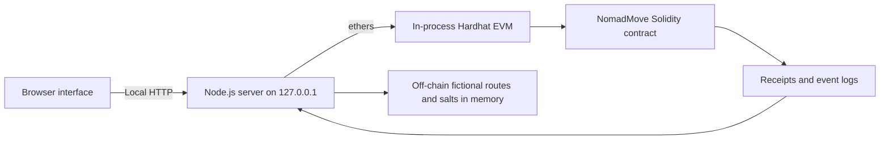

# NomadMove — Final Investment Proposal Prototype

> **Educational project for the Introduction to Finance course.** This repository contains an academic prototype and supporting technical evidence. It is not a commercial service, financial product, investment offer, or payment system. No real funds, tokens, personal addresses, or production credentials should be used.

## Project Information

| Item | Details |
|---|---|
| Project | NomadMove: A Decentralized Mobility and Driver-Empowerment Ecosystem |
| Course | Introduction to Finance |
| Team | Team 2, SE-2533 |
| Project type | Final Investment Proposal with a working academic prototype |
| Prototype version | 1.1.0 |
| Demonstration network | Local Hardhat EVM, chain ID 31337 |

## Project Overview

NomadMove is our proposed mobility platform for Kazakhstan. The business concept addresses two linked problems: high platform commissions that reduce drivers' net income and limited transparency in mobility-related transactions. Our investment proposal evaluates a platform commission of **5%**, partnerships with leasing companies, and a transparent audit layer for selected ride and payment records.

This repository provides technical evidence for the proposal. The prototype demonstrates a complete ride lifecycle, role-based smart-contract rules, transparent commission accounting, event records, and route-integrity verification. It does not claim to be a production taxi platform or a deployed public blockchain service.

## What the Prototype Demonstrates

- Passenger creation of a ride request with fictional route data and an illustrative fare.
- Administrator authorization and revocation of driver addresses.
- Driver actions through the required lifecycle: `Requested → Accepted → InProgress → Completed`.
- Passenger cancellation while a ride remains in the `Requested` state.
- Exact 5% platform commission calculated in integer KZT.
- Driver net earnings and platform totals recorded once at ride completion.
- Local EVM transaction receipts, block numbers, transaction hashes, and contract events.
- A salted route commitment stored on-chain while readable route details remain off-chain in memory.
- Verification of an unchanged route record and detection of a modified copy.
- Emergency pause and unpause controls available only to the administrator.
- Responsive English and Russian interfaces with an illustrative OpenStreetMap layer.

### Illustrative Commission Example

For an illustrative fare of **1,800 KZT**:

| Calculation | Amount |
|---|---:|
| Gross fare | 1,800 KZT |
| NomadMove commission (5%) | 90 KZT |
| Driver net amount before other expenses | 1,710 KZT |

These figures are accounting examples inside an academic simulation. The contract does not transfer Ether, tokens, or real money.

## Implemented Architecture



The browser communicates only with the local Node.js server. The server compiles and deploys the Solidity contract to an ephemeral Hardhat network and performs predefined actions with separate demonstration accounts. No MetaMask connection, external RPC endpoint, public deployment, production database, or real payment provider is used.

### On-chain and Off-chain Data

**On-chain:** synthetic addresses, ride ID, salted route commitment, fare, ride status, commission, driver net amount, aggregate totals, and emitted events.

**Off-chain:** fictional route names, selected map coordinates, and the random salt. These values exist only in local process memory and are reset when the server stops.

The investment proposal discusses a possible permissioned Hyperledger Fabric architecture for cooperation among mobility and leasing organizations. The implemented prototype instead uses Solidity and a local EVM to test the business rules. We explicitly distinguish the proposed production architecture from the technology used in this academic demonstration.

## Technology Stack

| Component | Version / Purpose |
|---|---|
| Node.js | 22 or 24; local server and scripts |
| Solidity | 0.8.28; `NomadMove` smart contract |
| Hardhat | 2.26.3; ephemeral local EVM |
| ethers | 6.15.0; contract deployment and interaction |
| solc-js | 0.8.28; local contract compilation |
| Leaflet | 1.9.4; local map interface library |
| OpenStreetMap | Visible map tiles for the illustrative route interface |

Direct dependency versions are fixed in `package.json`, and the reproducible dependency graph is stored in `pnpm-lock.yaml`.

## Installation and Local Launch

### Requirements

- Node.js 22 or 24
- pnpm recommended; npm may be used as a fallback
- Internet access during the first dependency installation and for visible OpenStreetMap tiles

### Recommended installation

```bash
pnpm install --frozen-lockfile --ignore-scripts
node server.cjs
```

### npm fallback

```bash
npm install --ignore-scripts
npm start
```

Open [http://127.0.0.1:4173](http://127.0.0.1:4173) after the server prints the local contract address and deployment transaction. Keep the server terminal open while using the prototype. Press `Ctrl+C` to stop it.

Windows users may also run `START.cmd` after dependencies have been installed. Opening `public/index.html` directly will not work because the interface requires the local API and blockchain process.

## Demonstration Scenario

1. Open **Passenger**, keep the fictional route and the 1,800 KZT illustrative fare, and create a ride.
2. Open **Driver**, then accept, start, and complete the ride.
3. Confirm the 90 KZT platform commission and 1,710 KZT driver net amount.
4. Open **Blockchain & Audit** and verify the original route record.
5. Test the modified-copy control and confirm that the integrity mismatch is detected.
6. Open **Administration** to review totals and demonstrate the emergency pause control.

The full three-minute presentation flow is documented in [`docs/DEMO-SCRIPT.md`](docs/DEMO-SCRIPT.md).

## Testing and Verification

Run the contract checks with:

```bash
pnpm run compile
pnpm test
```

or directly:

```bash
node scripts/compile.cjs
node --test --test-concurrency=1 test/ride.test.cjs
```

The test suite contains **13 sequential checks** covering the successful ride lifecycle, the 5% commission, rounding, access control, invalid state transitions, replay prevention, cancellation, pause behavior, driver revocation, active-ride restrictions, and rejection of Ether transfers. The current verified result is **13 passed, 0 failed**. Details are recorded in [`TESTING.md`](TESTING.md).

## Repository Structure

```text
contracts/NomadMove.sol       Smart-contract roles, ride states, commission and pause logic
scripts/compile.cjs           Local Solidity compilation
scripts/chain.cjs             Local deployment and demonstration accounts
server.cjs                    Local API and static-file server
public/                       Responsive RU/EN browser interface and local Leaflet files
test/ride.test.cjs            Thirteen contract behavior checks
docs/ARCHITECTURE.md          Architecture, sequence, roles and data boundary
docs/CONSENSUS.md             Sourced consensus and architecture comparison
docs/SECURITY.md              Threats, controls and remaining risks
docs/DEMO-SCRIPT.md           Short defense-video scenario
screenshots/                  Desktop and mobile evidence from the running prototype
```

## Security, Privacy, and Limitations

- Use only fictional routes and demonstration data.
- The role tabs are a demonstration interface, not user authentication.
- Test accounts are created by Hardhat and have no value outside the local network.
- The server binds to `127.0.0.1`; it is not designed for public hosting.
- Route verification proves commitment integrity, not that a physical trip occurred.
- The prototype has no production identity system, persistent database, real payment settlement, GPS tracking, fare-by-distance engine, dispute workflow, or external security audit.
- A server restart creates a fresh network, a new contract, and empty in-memory records.
- Automated tests provide evidence for the tested rules but do not prove complete security.

See [`docs/SECURITY.md`](docs/SECURITY.md) for the threat-control table and [`docs/CONSENSUS.md`](docs/CONSENSUS.md) for the sourced technology comparison.

## Team Contributions

| Team member | Project responsibility | Main contribution area |
|---|---|---|
| **Miras Kaldybek** | Project Leader and Business Analyst | Project coordination, problem definition, startup concept, business model, target market, report integration, and submission control |
| **Maksat Muratov** | Chief Financial Officer | Funding requirement, revenue and cost model, valuation assumptions, investor proposal, financial tables, and financial appendices |
| **Yeskendir Salimov** | Chief Technology Officer | Prototype implementation and verification, smart-contract and system architecture, technical risks, interim findings, and technical appendices |

All team members are expected to understand the business assumptions, financial logic, prototype workflow, limitations, and conclusions presented during the defense.

## Submission Artifacts

- **GitHub repository:** [NomadMove Final Investment Proposal](https://github.com/mirasItshnik/NomadMove-Final-Investment-Proposal)
- **Final report:** submitted separately through the university course platform
- **Presentation:** submitted separately through the university course platform
- **Prototype demonstration video:** the official university OneDrive viewing link must be added here after upload; no placeholder or fabricated link is used

## Open-source Attribution

This project uses Hardhat 2.26.3 (MIT), ethers 6.15.0 (MIT), solc-js 0.8.28 (MIT), and Leaflet 1.9.4 (BSD-2-Clause). The Leaflet license is included at [`public/vendor/leaflet/LICENSE`](public/vendor/leaflet/LICENSE). Map tiles and visible attribution are provided by OpenStreetMap under its published tile-use policy.

Official technical references:

- [Hardhat Network documentation](https://v2.hardhat.org/hardhat-network/docs/overview)
- [ethers v6 documentation](https://docs.ethers.org/v6/)
- [Solidity security considerations](https://docs.soliditylang.org/en/latest/security-considerations.html)
- [OpenStreetMap tile usage policy](https://operations.osmfoundation.org/policies/tiles/)
- [Leaflet documentation](https://leafletjs.com/)

## AI Disclosure Statement

The team used ChatGPT/Codex as a supporting tool during the project for brainstorming, report and repository organization, English-language improvement, documentation review, code-drafting and debugging assistance, and test-planning support. The team defined the project requirements and assumptions, reviewed and adapted the assisted material, executed the prototype, verified the 13 automated checks, checked the financial interpretation, and remains responsible for all submitted content, code, calculations, conclusions, and defense answers. AI assistance did not replace the team's academic responsibility or final decision-making. Any additional AI tools used by individual members must be added to this disclosure before submission.
