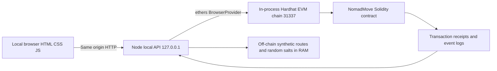
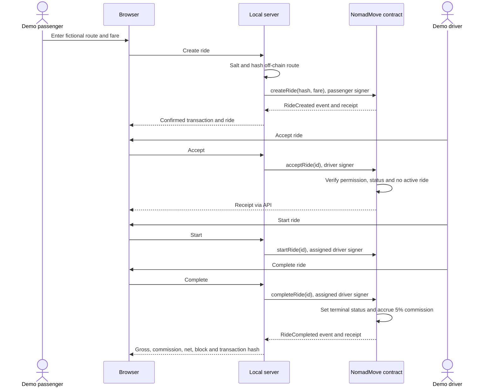

# Architecture and sequence

## Implemented architecture

Figure 1. Implemented local prototype architecture. Source: project implementation.

No public application endpoint, external database, wallet extension, real payment provider, or production consensus cluster is used. Hardhat automatically mines transactions for development. It does not demonstrate distributed validator consensus or Byzantine fault tolerance. Since version 1.1, the browser also requests visible map tiles from OpenStreetMap over HTTPS. This independent map layer does not send ride records or transactions to the tile provider. Selected coordinates remain off-chain and are included in the salted commitment.

## Sequence

Figure 2. Main ride lifecycle. Source: project implementation.

## Contract roles

| Role | Rights | Restrictions |
|---|---|---|
| Passenger (creator address) | Create a ride; cancel own Requested ride | One active ride; cannot progress driver's ride |
| Authorized driver | Accept requested ride; start and complete assigned ride | Cannot accept own ride; one active ride; no double completion |
| Admin (immutable deployer) | Grant/revoke drivers and pause/unpause | Cannot revoke a driver during an active ride; no arbitrary ride status editing |

Any address can act as a passenger at contract level; the browser uses one predefined test passenger. The test suite also exercises other addresses. Admin is not a production multi-signature implementation. UI tabs are not authentication.

## Data boundary

On-chain: synthetic account addresses, numeric ride ID, salted route commitment, integer KZT fare, status, commission, driver net, aggregate counts and emitted events. Off-chain: fictional route text and salt in process memory. Verification detects a changed commitment input, not whether a real physical trip occurred. Never put real addresses or passenger information into this educational UI.

## Relationship to the proposed Fabric design

This prototype verifies business rules using EVM. Fabric uses a different execution and identity model; the Solidity implementation is not directly deployable there. The report must state this implementation change instead of claiming Fabric has been deployed. The final choice of production architecture requires the team's Endterm report and reasoning.

The sourced comparison in [CONSENSUS.md](CONSENSUS.md) proposes Fabric Raft under an explicit trusted-consortium assumption and compares it with public Ethereum proof of stake. It distinguishes both from the automining development engine actually used here. No production consensus cluster has been deployed or benchmarked. This proposed refinement should be reconciled with the team's Endterm report; it does not assert an earlier decision that has not been supplied.

## Limitations

No external audit, production authentication, dispute handling, cancellation after acceptance, real fare calculation, persistent database, driver location tracking, lease contract, or settlement. A server restart resets both chain and off-chain data. There is no promise of immutable long-term storage. Local users control the development environment.
